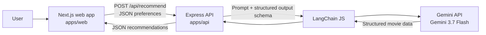
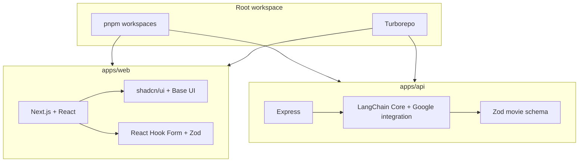

# ReelGood — AI Movie Finder

Find a film that fits the moment. ReelGood takes a short description of what someone wants to watch, along with genre, mood, and result count, then returns structured movie recommendations.


## Project overview

ReelGood is a TypeScript monorepo with two applications:

| App | Directory | Purpose | Local URL |
| --- | --- | --- | --- |
| Web | `apps/web` | Next.js interface for entering preferences and viewing recommendations | `http://localhost:3000` |
| API | `apps/api` | Express server that calls Gemini through LangChain and returns structured recommendations | `http://localhost:8080` |

The repository uses pnpm workspaces to install and manage the applications, and Turborepo to run development and build tasks across the monorepo.

## Architecture



### Recommendation flow

1. The user enters a request, genre, mood, and number of recommendations in the web form.
2. React Hook Form and Zod validate the form values in the browser.
3. The web app sends a JSON `POST` request to the Express API.
4. LangChain formats the request with a prompt template and asks Gemini for output matching the movie schema.
5. The API responds with a list of movies that the web app displays as cards.

The API currently uses structured output for the model response. It does not yet perform runtime Zod validation of the incoming request body.

## Dependency map



## Technology stack

| Area | Technology | Use |
| --- | --- | --- |
| Monorepo | pnpm workspaces | Package and dependency management across apps |
| Task runner | Turborepo | Run and cache app tasks from the repository root |
| Web framework | Next.js App Router | Web pages, loading UI, and client-side form interaction |
| UI | React, Tailwind CSS 4, shadcn/ui, Base UI | Components, styling, and accessible interface primitives |
| Forms | React Hook Form, Zod, `@hookform/resolvers` | Form state and browser-side input validation |
| API server | Express 5 | Health check and recommendation endpoint |
| AI orchestration | LangChain JS (`@langchain/core`, `@langchain/google`) | Prompt templates, chat model integration, structured output |
| Model | Google Gemini 3.7 Flash | Generates movie recommendations |
| API response schema | Zod | Defines the expected recommendation and movie fields |
| Language | TypeScript | Types for the web app and API |

## Repository structure

```text
.
├── apps/
│   ├── api/
│   │   └── src/
│   │       ├── controllers/       # Express request handlers
│   │       ├── routes/            # API route definitions
│   │       ├── schemas/           # Zod movie response schema
│   │       ├── services/          # LangChain and Gemini integration
│   │       ├── types/             # API request types
│   │       └── server.ts          # Express server entry point
│   └── web/
│       ├── app/                   # Next.js routes, layout, and global styles
│       ├── components/ui/          # shadcn UI primitives
│       ├── components/web/         # Movie finder components
│       ├── lib/                   # Web form schema and helpers
│       └── types/                 # Movie response types
├── package.json                   # Root scripts and toolchain
├── pnpm-workspace.yaml            # Workspace package locations
├── pnpm-lock.yaml                 # Locked dependency versions
└── turbo.json                     # Turborepo task configuration
```

## Requirements

| Requirement | Version |
| --- | --- |
| Node.js | `>=24` |
| pnpm | `11.25.0` (declared by the root package) |
| Google Gemini API key | Required to generate recommendations |

## Getting started

### 1. Install dependencies

Run from the repository root:

```bash
pnpm install
```

### 2. Configure the API environment

Copy the API example environment file and add your Gemini API key:

```bash
cp apps/api/.env.example apps/api/.env
```

Set the values in `apps/api/.env`:

| Variable | Purpose | Example |
| --- | --- | --- |
| `PORT` | Port used by the Express server | `8080` |
| `FRONTEND_URL` | Browser origin allowed by CORS | `http://localhost:3000` |
| `GEMINI_API_KEY` | Credential for the Gemini API | Your key from Google AI Studio |

Keep `.env` files and API keys private. Do not commit real credentials.

### 3. Configure the web app

Create `apps/web/.env.local` with the API base URL:

```env
NEXT_PUBLIC_API_URL=http://localhost:8080
```

This URL is used by the browser to contact the Express API. It is public configuration and must not contain secrets.

### 4. Start the applications

Run both apps from the repository root:

```bash
pnpm dev
```

Or start them individually in separate terminals:

```bash
pnpm --filter api dev
```

```bash
pnpm --filter web dev
```

The web app runs at `http://localhost:3000`; the API defaults to `http://localhost:8080`.

## API reference

| Method | Path | Purpose |
| --- | --- | --- |
| `GET` | `/health` | Confirm the API server is running |
| `POST` | `/api/recommend` | Generate structured movie recommendations |

### Recommendation request

`POST /api/recommend`

```json
{
  "userPrompt": "Recommend character-driven dramas about grief and rebuilding a life.",
  "genre": "Drama",
  "mood": "Reflective and emotionally complex",
  "count": 3
}
```

### Successful response

```json
{
  "success": true,
  "result": {
    "movies": [
      {
        "title": "Example Film",
        "year": 2020,
        "genre": ["Drama"],
        "cast": ["Actor One", "Actor Two"],
        "reason": "A character-focused story that explores grief and change.",
        "rating": 4.1
      }
    ]
  }
}
```

The response schema includes a title, release year, genre list, cast list, recommendation reason, and a model-generated rating from 1 to 5. Treat the rating as a model estimate, not a verified external rating.

### Health check

```bash
curl http://localhost:8080/health
```

## Workspace commands

Run root commands from the repository root:

| Command | Purpose |
| --- | --- |
| `pnpm dev` | Start all apps with a `dev` task |
| `pnpm --filter web dev` | Start only the Next.js app |
| `pnpm --filter api dev` | Start only the Express API |
| `pnpm build` | Run available build tasks through Turborepo |
| `pnpm lint` | Run available lint tasks through Turborepo |
| `pnpm format` | Format TypeScript, TSX, and Markdown files with Prettier |
| `pnpm --filter web typecheck` | Type-check the web app |
| `pnpm --filter api typecheck` | Type-check the API |

**Type-check task note:** the root currently defines `pnpm check-types` as a Turborepo task, while both app packages name their scripts `typecheck`. Use the two package-level commands above until those task names are aligned.

## Current scope

- The web form accepts a free-text request, genre, mood, and recommendation count.
- The API returns structured movie data through LangChain and Gemini.
- Movie posters are currently represented by styled placeholders; no movie database or poster service is connected.
- The API currently uses in-memory request handling and does not persist user data or recommendation history.
- Model generation can take time; the web results panel displays a loading skeleton while the request is in progress.

## Security notes

- Store `GEMINI_API_KEY` only in the API environment file.
- `NEXT_PUBLIC_API_URL` is exposed to the browser and should contain only the API base URL.
- CORS allows the origin configured by `FRONTEND_URL`.
- Incoming request values currently rely on client-side validation and TypeScript types; add server-side validation before accepting untrusted production traffic.
